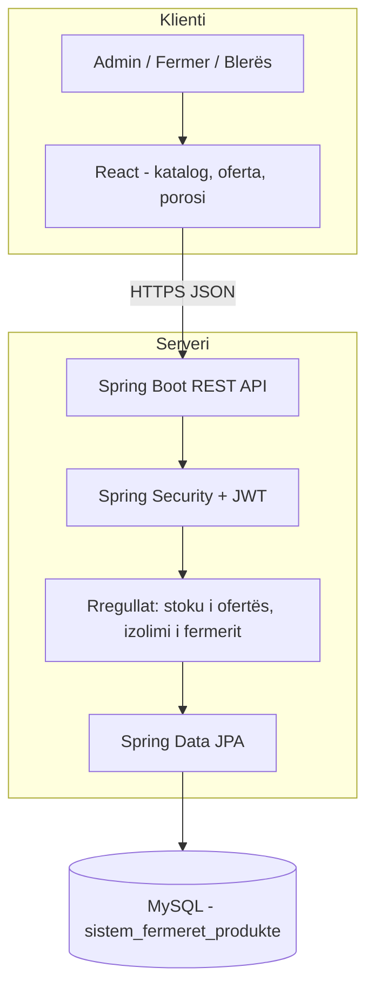
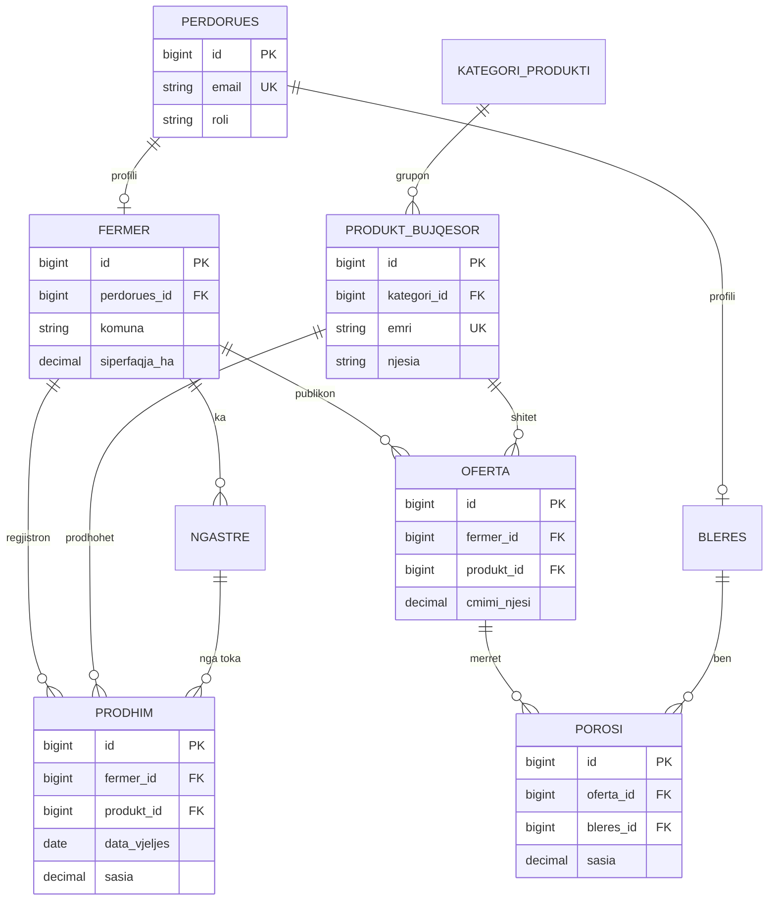

# Raporti Teknik 1 – Analiza, kërkesat dhe dizajni teknik

**Projekti:** Sistemi për Menaxhimin e Fermerëve dhe Produkteve Bujqësore  
**Studenti:** Mendim Shala  
**Email:** 240329048.b@uni-prizren.com  
**Lënda:** Projekt – Praktikë Profesionale | Semestri V  
**Repository:** https://github.com/MendimShala/Sistem-menaxhimi-Fermereve

Ky raport vendos bazën e projektit. Nuk pret aplikacion të përfunduar, por vendime të qarta për problemin, përdoruesit, kërkesat, arkitekturën dhe modelin e të dhënave.

---

## 1. Problemi që zgjidh projekti

Fermerët e kanë të vështirë ta mbajnë evidencën se **kush prodhon çfarë**, në çfarë sasie, me çfarë çmimi dhe kujt i shitet. Katalogu i produkteve bujqësore (grurë, domate, mjaltë, qumësht, etj.) shpesh mbetet në fletore ose Excel. Blerësit (dyqane, pika grumbullimi, kooperativa) nuk e shohin në një vend të vetëm se cilët fermerë kanë produkt të disponueshëm.

Sistemi ofron një platformë web ku:

- regjistrohen **fermerët** (profili, lokacioni, sipërfaqja e tokës);
- menaxhohet **katalogu i produkteve bujqësore**;
- fermeri regjistron **prodhimin** dhe **ofertën për shitje**;
- blerësi bën **porosi**;
- administratori mbikëqyr llogaritë dhe katalogun.

**Përdoruesit për të cilët ndërtohet sistemi:**

| Roli | Kush është | Çfarë bën |
|------|------------|-----------|
| Administrator | personi i sistemit | krijon/çaktivizon llogari, menaxhon katalogun e produkteve dhe kategoritë |
| Fermer | prodhuesi bujqësor | plotëson profilin, ngastrat, prodhimin, ofertat; sheh porositë e veta |
| Blerës | dyqan, grumbullues, kooperativë | kërkon produkte, bën porosi, ndjek statusin |

Nuk ndërtohet sistem i brendshëm i stafit të fermës (punëtorë, vaksinime, detyra ditore). Fokusi i temës është **fermeri** dhe **produkti bujqësor**.

---

## 2. Fluksi kryesor i aplikacionit

1. Përdoruesi hyn me email dhe fjalëkalim.
2. Nëse është fermer, plotëson ose përditëson profilin (komuna, fshati, sipërfaqja).
3. Administratori mban katalogun: kategori + produkt (p.sh. Perime → Domate, njesi KG).
4. Fermeri regjistron një prodhim: cilin produkt, sa, kur u vu, në cilën ngastër.
5. Fermeri publikon një ofertë: sasia për shitje dhe çmimi për njësi.
6. Blerësi kërkon produktin, sheh fermerët që e ofrojnë, bën porosi.
7. Fermeri e pranon ose e anulon porosinë; sasia e ofertës zvogëlohet.

Ky është rrjedha kryesore e semestrit. Nuk ka pagesë online dhe as dërgesë me GPS.

---

## 3. Funksionalitetet që do të implementohen gjatë semestrit

1. Regjistrim dhe hyrje, me role ADMIN / FERMER / BLERES.
2. Profili i fermerit (komuna, fshati, adresa, sipërfaqja në ha).
3. Profili i blerësit (emri i biznesit, komuna).
4. CRUD i kategorive dhe i katalogut të produkteve (admin).
5. CRUD i ngastrave të tokës së fermerit.
6. Regjistrimi i prodhimit (fermër + produkt + sasi + datë vjeljeje + cilësi).
7. Publikimi i ofertës për shitje (sasi, çmim, status).
8. Kërkim/filtrim i produkteve dhe ofertave (sipas produktit, komunës, çmimit).
9. Krijimi i porosisë nga blerësi.
10. Fermeri ndryshon statusin e porosisë (PRITJE / PRANUAR / DORAZUAR / ANULUAR).
11. Paneli i fermerit: sa produkte ka në ofertë, sa porosi në pritje.
12. Paneli i administratorit: numri i fermerëve, produkteve, porosive.
13. Çaktivizimi i një llogarie nga admin; ai përdorues nuk hyn më.

---

## 4. Kërkesat funksionale (konkrete dhe të testueshme)

| ID | Kërkesa funksionale | Si testohet |
|----|---------------------|-------------|
| KF-01 | I paregjistruari krijon llogari me emër, mbiemër, email, fjalëkalim (≥ 8 karaktere) dhe zgjedh rolin FERMER ose BLERES. | Të dhëna të vlefshme → llogaria ekziston; email i dyfishtë → gabim. |
| KF-02 | Fermeri i autentikuar plotëson profilin me komunë, fshat dhe sipërfaqe > 0. | Sipërfaqe 0 ose fshat bosh → 400; pas ruajtjes profili lexohet. |
| KF-03 | Përdoruesi i paautentikuar nuk krijon ofertë. | POST `/api/ofertat` pa token → 401. |
| KF-04 | Admin shton produkt në katalog me emër unik, kategori dhe njësi. | Emër i dyfishtë “Domate” → gabim unik. |
| KF-05 | Fermeri regjistron prodhim: produkt ekzistues, sasi > 0, datë vjeljeje. | Produkt i pabindur → 400; sasi 0 → 400. |
| KF-06 | Fermeri publikon ofertë për një produkt të katalogut, me sasi dhe çmim ≥ 0. | Oferta shfaqet te lista e ofertave AKTIVE. |
| KF-07 | Blerësi krijon porosi mbi një ofertë AKTIVE; sasia e porosie ≤ sasia e ofertës. | Porosi 30 kur oferta ka 20 → 400. |
| KF-08 | Kur porosia PRANOHET, `sasia_disponueshme` e ofertës zvogëlohet me sasinë e porositur dhe `shuma_totale` = sasia × cmimi_njesi. | 100 − 10 = 90; shuma e saktë. |
| KF-09 | Fermeri sheh vetëm porositë e ofertave të veta, jo të fermerëve të tjerë. | Token i fermerit A te porosia e B → 403. |
| KF-10 | Blerësi filtron ofertat sipas emrit të produktit (p.sh. “Domate”). | Rezultati përmban vetëm oferta të atij produkti. |
| KF-11 | Admin çaktivizon përdoruesin; hyrja e radhës dështon. | `aktiv = 0` → mesazh i qartë, pa token. |
| KF-12 | Fermeri shton ngastër me emër dhe sipërfaqe > 0, të lidhur me profilin e tij. | `ngastre.fermer_id` = fermeri i loguar. |

---

## 5. Kërkesat jofunksionale (konkrete dhe të testueshme)

| ID | Kërkesa jofunksionale | Si testohet |
|----|----------------------|-------------|
| KJ-01 | Fjalëkalimet ruhen vetëm si hash (BCrypt). Nuk ka kolonë me fjalëkalim tekst. | `fjalekalimi_hash` fillon me `$2`. |
| KJ-02 | Endpoint-et private kërkojnë JWT. Pa token → HTTP 401. | `/api/fermeret/unë` pa Authorization → 401. |
| KJ-03 | Hyrja, lista e ofertave, forma e prodhimit dhe porosia mbeten të përdorshme në gjerësi 375px. | Pa scroll horizontal; butonat klikohen. |
| KJ-04 | API kthen gabim JSON me fushën `mesazhi`. | Validim i dështuar → `{ "mesazhi": "..." }`. |
| KJ-05 | Lista e ofertave aktive kthehet nën 2 sekonda për deri në 500 rreshta lokal. | Matje me Postman / DevTools. |
| KJ-06 | Blerësi nuk ndryshon ofertën e fermerit (vetëm lexon dhe porosit). | PUT nga blerësi → 403. |

---

## 6. Teknologjitë e zgjedhura dhe arsyeja

```
Frontend (React)
        ↓  HTTPS / REST JSON
Backend  (Java Spring Boot)
        ↓  JDBC / Spring Data JPA
Databaza (MySQL)
```

**React.** Paneli ka lista (fermerë, produkte, oferta, porosi) dhe forma. React i ndan në komponentë dhe i përditëson pa ringarkuar faqen.

**Java Spring Boot.** Gjuha e programit të studimeve. Jep REST, validim dhe siguri (hash, JWT, role) pa ndërtuar server nga zero.

**MySQL.** Tema është relacionale: fermer–prodhim–produkt, ofertë–porosi. InnoDB jep PK, FK dhe UNIQUE. MongoDB nuk e shpreh këtë integritet që kërkon raporti.

**Pse jo PHP i përzier ose desktop JavaFX.** Raporti kërkon ndarje Frontend → API → Backend → DB. Web-i hapet edhe në ekran të vogël (KJ-03).

---

## 7. Diagrami i arkitekturës



| Shtresa | Përgjegjësia |
|---------|----------------|
| UI | shfaqje, filtrim, forma |
| API | kontrata HTTP 200/400/401/403 |
| Siguria | BCrypt, JWT, role |
| Biznesi | sasia e ofertës, unikiteti i produktit, pronësia |
| Persistenca | tabela, FK, transaksione |

Frontend nuk flet drejtpërdrejt me MySQL.

---

## 8. Modeli fillestar i databazës

Skema SQL: [`database/schema.sql`](../database/schema.sql).

### Entitetet kryesore

| Entitet | PK | Të detyrueshme | Shënime |
|---------|----|----------------|---------|
| perdorues | id | emri, mbiemri, email, fjalekalimi_hash, roli | email unik |
| fermer | id | perdorues_id, komuna, fshati, siperfaqja_ha | 1:1 me llogarinë FERMER |
| ngastre | id | fermer_id, emri, siperfaqja_ha | toka e fermerit |
| kategori_produkti | id | emri | p.sh. Perime, Drithëra |
| produkt_bujqesor | id | kategori_id, emri, njesia | katalog i përbashkët |
| prodhim | id | fermer_id, produkt_id, data_vjeljes, sasia | lidh fermerin me produktin |
| oferta | id | fermer_id, produkt_id, sasia_disponueshme, cmimi_njesi, data_publikimit | për shitje |
| bleres | id | perdorues_id, emri_biznesit, komuna | 1:1 me llogarinë BLERES |
| porosi | id | oferta_id, bleres_id, sasia, shuma_totale, statusi | |

### Relacionet dhe arsyetimi (si te shembulli TaskFlow)

**perdorues 1 — 1 fermer.**  
Profili bujqësor është i ndarë nga llogaria. Admin dhe blerësi nuk kanë komunë/sipërfaqe. `perdorues_id` është unik te `fermer`.

**fermer 1 — N ngastre.**  
Një fermer ka disa copa toke. Një ngastër i takon një fermeri. Nuk është N:N sepse e njëjta ngastër nuk menaxhohet nga dy fermerë në këtë sistem.

**kategori 1 — N produkt_bujqesor.**  
Produkti “Domate” i takon një kategorie (“Perime”). Nuk është N:N; klasifikimi duhet i qartë për filtrim.

**fermer N — N produkt_bujqesor, përmes `prodhim`.**  
Ky është relacioni qendror i temës. Një fermer prodhon domate **dhe** mjaltë. Të njëjtat “Domate” i prodhojnë shumë fermerë. Nëse `produkt_id` do të vihej drejtpërdrejt te `fermer`, fermeri do të kishte vetëm një produkt — gabim për temën. Tabela `prodhim` ruan edhe sasinë, datën dhe cilësinë.

**fermer 1 — N oferta; produkt 1 — N oferta.**  
Oferta është “ky fermer shet këtë produkt tani, me këtë çmim”. Nuk është e njëjta gjë me prodhimin (prodhimi është evidencë; oferta është treg).

**oferta 1 — N porosi.**  
Disa blerës porositin të njëjtën ofertë. Një porosi i takon një oferte. Për këtë semestër nuk bëhet “shportë me shumë produkte” (do të ishte N:N porosi–produkt); kjo mbetet jashtë scope-it.

**bleres 1 — N porosi.**  
Blerësi ka historikun e porosive të veta.



---

## 9. Plan i shkurtër deri te Raporti 2

| Javë | Çfarë përfundon |
|------|-----------------|
| 1 | Spring Boot + React; regjistrim/hyrje JWT; role |
| 2 | Profili i fermerit + CRUD i katalogut (admin) |
| 3 | Ngastrat + regjistrimi i prodhimit |
| 4 | Ofertat (publikim, listë, filtrim) |
| 5 | Porositë (blerësi porosit, fermeri pranon) + dashboard i thjeshtë |

**Nuk pretendet për Raportin 2:** pagesa, faturë PDF, shportë me shumë artikuj, harta e komunave.

---

## 10. Jashtë scope-it të këtij semestri

- Pagesë online / e-banking.
- Aplikacion native Android/iOS (vetëm web responsive).
- Menaxhim i brendshëm i fermës: punëtorë, bagëti me nr. veshjeje, vaksinime, detyra ditore.
- IoT, moti, GPS i traktorëve.
- AI për sëmundje të bimëve.
- Integrim me e-Kosova / agjenci shtetërore.
- Shportë me shumë produkte në një porosi.
- Shumë gjuhë (UI vetëm shqip).

---

## 11. Përgjigje për pyetjet tipike të Raportit 1

**Pse ky tech stack?**  
Java nga kursi, React për panelin e katalogut/ofertave, MySQL për relacione fermer–produkt–porosi. Përputhet me Frontend → API → Backend → DB.

**Cili është flow-i kryesor?**  
Hyrje → profil fermeri / katalog produktesh → prodhim → ofertë → porosi e blerësit → ndryshim statusi.

**Cilat janë entitetet kryesore?**  
Përdorues, Fermer, Ngastër, Kategori, Produkt bujqësor, Prodhim, Ofertë, Blerës, Porosi.

**Pse ky relacion është 1:N dhe jo N:N?**  
Ngastër–fermer është 1:N: toka i takon një fermeri. Fermer–produkt është N:N përmes `prodhim`, sepse shumë fermerë prodhojnë të njëjtin produkt dhe një fermer prodhon shumë produkte.

**Çfarë është jashtë scope-it?**  
Pagesa, mobile native, stafi i brendshëm i fermës, IoT, AI, shporta e përbërë — seksioni 10.

---

## 12. Struktura fillestare e repository-t

```
backend/     Spring Boot (com.ferma.sistemi)
frontend/     React (Vite)
database/     schema.sql
docs/         ky raport + prezantimi
```

Funksionet nuk janë implementuar ende, siç e lejon Raporti 1. Modeli është i ndërtuar rreth temës: **fermerët** dhe **produktet bujqësore**.
